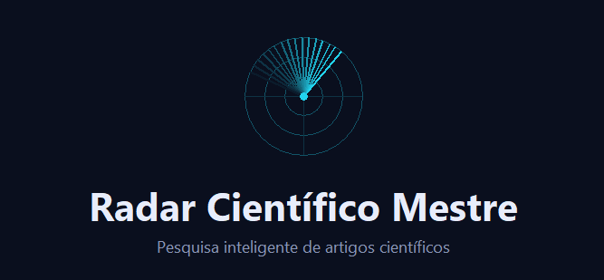
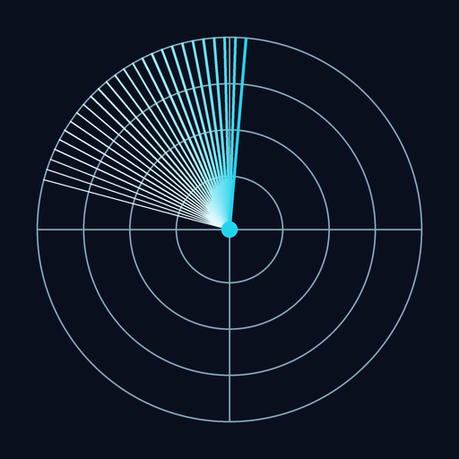

<div align="center">



[](https://github.com/Tech-Thiago/radar-cientifico-mestre/releases/latest)
[](https://github.com/Tech-Thiago/radar-cientifico-mestre/releases)
[](#-instalação)
[](#-licença)

</div>

---

## 📖 O que é

O Radar Científico Mestre é um programa de desktop para Windows que pesquisa artigos científicos novos, seja por tema, por autor ou por DOI, usando a base de dados aberta [OpenAlex](https://openalex.org). Em vez de você entrar em vários sites e repetir a mesma busca manualmente, basta abrir o programa, salvar seus temas de pesquisa e rodar todos de uma vez. Se quiser, ele também já te envia o resultado por e-mail, organizado e pronto, no mesmo momento em que você faz a busca.

> [!TIP]
> Pense nele como um **"atalho"** para a sua rotina de pesquisa: você define os temas uma vez, e quando quiser atualizar, roda tudo com um clique só.

---

## ✨ Funcionalidades

| | |
|---|---|
| 🔍 **Busca inteligente** | Por palavras-chave, autor ou DOI, com filtros de data, tipo (artigo/revisão) e palavras excluídas |
| 📬 **Boletim por e-mail** | Envia os resultados automaticamente via Gmail (login com Google ou senha de app) |
| 🗂️ **Temas salvos** | Salve suas linhas de pesquisa e rode todas de uma vez com um clique |
| ⭐ **Favoritos e histórico** | Marque o que importa e nunca receba o mesmo artigo duas vezes |
| 📤 **Exportação** | Gere arquivos em BibTeX, RIS, Excel ou CSV para usar no seu gerenciador de referências |
| 🔄 **Atualização automática** | O programa confere sozinho se há uma versão mais nova disponível |

---

## 🚀 Instalação

1. Baixe o instalador mais recente na página de **[Releases](https://github.com/Tech-Thiago/radar-cientifico-mestre/releases/latest)**.
2. Execute o `.exe` e siga o assistente de instalação.
3. Abra o programa e, na tela de **Configurações**, informe:
   - sua **chave gratuita da OpenAlex** ([obtenha aqui](https://openalex.org)), opcional, mas recomendado;
   - o **e-mail** que vai receber os boletins (login com Google ou senha de app do Gmail).

---

## 🧭 Como usar

```
1. Digite palavras-chave do seu tema de pesquisa (ou um nome de autor, ou um DOI)
2. Defina o período de datas e os filtros desejados
3. Clique em "🚀 Iniciar Radar Mestre"
4. Salve o tema (💾) para repetir a busca depois com um clique
5. Ative o envio por e-mail para receber os resultados automaticamente
```

<details>
<summary>📌 Quer rodar todos os seus temas salvos de uma vez?</summary>
<br>

Use o botão **"Rodar todos os temas salvos"**. O programa pesquisa cada tema, junta tudo sem repetir artigos, e envia (ou organiza) o resultado consolidado.
</details>

---

## 🛠️ Tecnologia

Construído em **Python** com interface gráfica em **Tkinter**, consumindo a API pública da **[OpenAlex](https://openalex.org)** para os dados bibliográficos e a **API do Gmail / SMTP** para o envio de e-mails.

---

## 🤝 Contribuindo

Sugestões, relatos de bugs e pull requests são bem-vindos! Abra uma [issue](https://github.com/Tech-Thiago/radar-cientifico-mestre/issues) contando o que encontrou ou o que gostaria de ver.

## 📄 Licença

Este projeto está sob uma licença de uso pessoal. Veja o arquivo [LICENSE.md](LICENSE.md) para os termos completos.

---

<div align="center">

<br>

 **Feito por [Tech-Thiago](https://github.com/Tech-Thiago)**

Se este projeto te ajudou, deixe uma ⭐

<sub>Criado originalmente para a Mavi 💙</sub>

</div>
